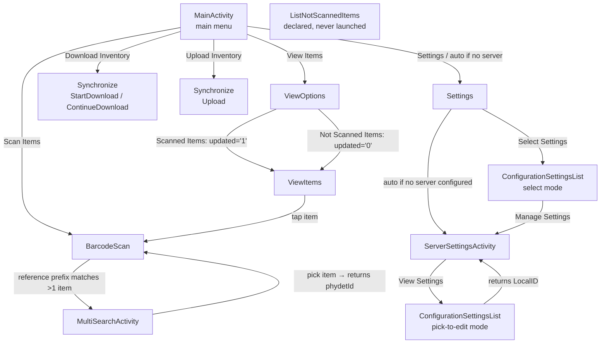

# Legacy Analysis — ERPDataCollectorN (handheld physical-count app)

Source analysed: `ERPDataCollectorN/` (Eclipse ADT project, read-only, not modified).
Package: `com.example.erpdatacollectorn`, minSdk 8, targetSdk 18, build target android-19.
Libraries: `ksoap2-android-assembly-3.6.2` (SOAP client), `android-support-v4` (CursorAdapter).
The newest build output is `bin/ERPDataCollectorN.apk` (24 Mar 2025). Its class list matches `src/` one-to-one, so the source appears to be the code that was actually shipped.

> **Key finding up front:** there is **no Speeddata SDK in this project**. There is no vendor jar in `libs/`, no vendor imports, no `.so` files, no broadcast receiver, and no Speeddata/scan-manager strings in the compiled `classes.dex`. The app gets barcodes through **keyboard-wedge input**: the scanner "types" the barcode into a text field and then presses Enter. See [§6](#6-scanner--hardware-specific-code). If the Speeddata integration exists, it lives in a different codebase or in the device's own scanner settings. It is not in this folder.

---

## 1. Architecture at a glance

| Concern | Implementation |
|---|---|
| UI | 10 `Activity` classes, each with its own XML layout. Navigation uses `startActivityForResult`. |
| Local storage | SQLite through `openOrCreateDatabase` with raw SQL built by string concatenation. One settings DB plus one data DB **per location**. |
| Preferences | `SharedPreferences` file `ERPDataCollectorNSettings`, wrapped by `ConfigurationSettings.java`. |
| Server | .NET ASMX SOAP 1.1 web service at `http://<serviceUrl>/ERPDataCollector/Service1.asmx`, namespace `http://tempuri.org/`, plain HTTP, 30 s timeout. |
| Threading | `StrictMode.permitAll()` (`MainActivity.java:61`). Downloads and uploads run on raw `Thread`s and report back to the UI through a `Handler`. |

---

## 2. Screens and flow

### 2.1 Navigation map



### 2.2 MainActivity (launcher) — `MainActivity.java`, `activity_main.xml`

Buttons: **Scan Items**, **View Items**, **Download Inventory**, **Upload Inventory**, **Settings**. The `textView_status` view is unused.

On create (`:57-150`):
1. Loads `ConfigurationSettings`. If `serviceUrl` is blank, it opens **Settings** immediately.
2. Otherwise it opens the data DB (`cs.DBName`) and runs `CheckTables()`.

`CheckTables()` / `CheckPullStatus()` (`:340-456`) work out the download state for the current **LocCode + MachineName** from `tblPullStatus`:

| State | Condition | Effect |
|---|---|---|
| `NotStarted` (0) | `tblPullStatus` missing, or has no rows for this location+machine | Scan, Upload and View are **disabled** |
| `NotCompleted` (1) | Any row has `PullFinished='0'` | Scan, Upload and View are **disabled** |
| `Completed` (2) | Every row has `PullFinished='1'` and every `OriginalTableName` exists | All buttons enabled |

Self-healing (`:427-435`): if a row says finished but its table is missing, the row is reset to `PullFinished='0', LastImportedRow='0'`.

**Download Inventory** behaviour depends on the state (`:106-127`):
- **NotStarted**: clears `SelectedRecId`, then shows the prompt **"Enter Physical Count Number"** (`askForPhysicalCountNumber`, `:153`). The number is stored in `SelectedRecId`, and then `Synchronize(StartDownload)` starts.
- **NotCompleted**: shows a dialog with **Restart Download** (clear the number, prompt again, full restart) or **Continue Download** (`Synchronize(ContinueDownload)` with the existing number).
- **Completed**: asks *"Do You Want To Delete Current Database And ReDownload?"* **Yes** clears the number, prompts, and does a full restart.

When returning from any child activity (`onActivityResult`, `:279-312`), the app reloads settings. If there is still no server URL it calls **`finish()`, which closes the app**. After a download (request code 504), if `phyDetails` does not exist, it drops every pulled table and warns *"Selected Inventory Not Download Or Does Not Exist!!!"*.
Note that `ACTIVITY_Download` and `ACTIVITY_Upload` are both `504`, so this check also runs after an upload. It does no harm there.

The prompt's input type is `TYPE_CLASS_TEXT | TYPE_CLASS_NUMBER`, which evaluates to 3, the same as `TYPE_CLASS_PHONE`. In practice this shows a phone keypad. The value is not validated.

### 2.3 BarcodeScan — `BarcodeScan.java`, `activity_barcode_scan.xml`

This is the counting screen. The fields are:
- `txtbar`: the scan input, which has focus.
- Read-only labels: **Id** (`Pcd_RecId`), **Reference**, **Description**, **Expiry**, **Lot**, **Avlb Qty** (`Pcd_Qty`, the system quantity).
- `tvTotalScannedt` (**Total Qty Scanned**, editable) and the **Update Total Scanned** button.
- `tvCountedQty2` (**Last Scanned**, editable) and the **Update Last Scan Qty** button.
- **Cancel Last Scan** button.

Behaviour:
- If the header setting `SP_Expiry = 'N'`, the Expiry and Lot rows are hidden (`:70-75`).
- If `SP_DecNo != '0'`, the two quantity fields accept decimals (`:91-97`).
- Pressing Enter in `txtbar` runs the lookup and increment, then `Reinit()` refocuses and selects all text in `txtbar` after 100 ms so the next scan replaces it (`:171-194`).
- The screen can be opened with the extra `phydetId` (from ViewItems). In that case it only **displays** the item and does not increment (`:155-161`).
- At the end of `onCreate`, the Last Scanned field and both last-scan buttons are disabled. They become enabled after an item loads.
- Full rules are in [§5](#5-business-rules).

### 2.4 MultiSearchActivity — `MultiSearchActivity.java`

This screen is titled "Search By Reference". It opens from BarcodeScan when the scanned text matches **more than one** `phyDetails.Refernce` by prefix. The search box is pre-filled with the scanned text and re-queries on every keystroke with `Refernce LIKE '<text>%'`. If nothing matches, it shows an empty list (`where 0=1`).
Tapping a row returns `phydetId` to BarcodeScan, which then **increments and saves** that item (`BarcodeScan.java:426-431`).
There is also a `ParentActivity == "ViewOptions"` branch that opens BarcodeScan directly, but nothing launches this screen with that value.

### 2.5 ViewOptions → ViewItems — `ViewOptions.java`, `ViewItems.java`

ViewOptions has two buttons:
- **Scanned Items** opens `ViewItems` with `where updated = '1'`.
- **Not Scanned Items** opens `ViewItems` with `where updated = '0'`.

ViewItems lists `SELECT * FROM phyDetails <whereCond>` using `ItemsCursorAdapter` (row layout `lst_items.xml`: Id, Reference, Desc, Expiry, Lot, Avlb Qty, Counted). Expiry and Lot are hidden when `SP_Expiry='N'`. Tapping a row opens BarcodeScan in view mode, and the list refreshes when you come back.
**Items already uploaded (`updated='2'`) do not appear in either list.**

### 2.6 Synchronize — `Synchronize.java`, `activity_synchronize.xml`

This progress screen handles download and upload. It has a header, a chronometer, a detail line, a percentage progress bar, a **Cancel** button (sets `StopTransfer=true`, which is checked between pages and items), and a **Close** button that appears when the operation finishes. It holds a `SCREEN_DIM_WAKE_LOCK` until destroyed.
The `Operation` extra selects the mode: `StartDownload`, `ContinueDownload`, or `Upload`. The protocol is described in [§4](#4-receiving-sheets-download-and-sending-counts-upload).
When an operation succeeds (download or upload), `finishOperation2` copies `SP_DecNo, SP_Fashion, SP_Expiry` from `phyHeader` into preferences and into the selected `tblConfigurationSettings` row (`:204-249`).

### 2.7 Settings — `Settings.java`, `activity_settings.xml`

Fields:
- **Location** and **Server**: read-only, taken from the selected profile.
- **Machine Name** and **Download size** (records per page, default 5000): editable.

Buttons:
- **Select Settings** opens ConfigurationSettingsList in select mode.
- **Save Settings** calls `savesettings2` and sets `DBName = "ERPDataCollectorNDB_" + LocCode`. If Download size is empty, `Integer.valueOf` throws an uncaught exception and **the app crashes**.
- **Restore Uploaded** asks for confirmation, then runs `UPDATE phyDetails SET updated='1' WHERE updated='2'` so every uploaded line is sent again. It is disabled when `phyDetails` does not exist.

On open, and on return from child screens, `LoadSelectedSettings()` copies the `Selected=1` profile into preferences. If no profile is selected, `saveEmpty()` **clears `serviceUrl` and `DBName`**.
If no server is configured, the screen opens ServerSettingsActivity automatically.

### 2.8 ServerSettingsActivity — `ServerSettingsActivity.java`

This is the CRUD screen for connection profiles. Fields: **Location** (max 2 characters), **Server** (host or `host:port`, without `http://`), and the **Is Selected** checkbox.
- **Save** requires both fields. If Is Selected is checked, it first unselects every other profile, then inserts (when `LocalID=0`) or updates the row, then re-applies the selected profile to preferences.
- **Delete** asks for confirmation, then deletes the loaded profile.
- **View Settings** opens ConfigurationSettingsList in pick mode, which returns a `LocalID` to edit.

### 2.9 ConfigurationSettingsList — `ConfigurationSettingsList.java`

Lists `tblConfigurationSettings` (Location, Server, Is Selected).
- **Select mode** (opened from Settings, with no `ParentActivity` extra): tapping a row sets `Selected=0` on all profiles, `Selected=1` on the tapped one, and writes that profile to preferences with `DBName = ERPDataCollectorNDB_<LocCode>`. This **switches which location database the whole app uses**.
- **Pick mode** (opened from ServerSettings): the Manage button is hidden and the screen only returns the `LocalID`.

### 2.10 ListNotScannedItems — dead code

It is declared in the manifest and would list `phyDetails`, but nothing launches it. ViewItems replaced it.

---

## 3. Databases, tables and queries

### 3.1 Database files

| DB file | Opened by | Contents |
|---|---|---|
| `SSDCSettings` | `DBHelper` (SQLiteOpenHelper, version 1) | `tblConfigurationSettings` |
| `ERPDataCollectorNDB_<LocCode>` (fallback `ERPDataCollectorNDB`) | `openOrCreateDatabase(cs.DBName)` in every data screen | `tblPullStatus`, plus the tables the server defines: `phyHeader`, `phyDetails`, `phyBarcodes` |

**Each location has its own data DB.** Switching the selected profile switches the dataset.

### 3.2 SharedPreferences `ERPDataCollectorNSettings`

| Key | Default | Meaning |
|---|---|---|
| `serviceUrl` | `""` | Server host. The URL becomes `http://<serviceUrl>/ERPDataCollector/Service1.asmx` |
| `MachineName` | `""` | Free text typed by the user. It identifies the device to the server and is part of the `tblPullStatus` key |
| `LocCode` / `LocDesc` | `""` | Location code (2 characters); `LocDesc` is never set in the UI |
| `DBName` | `ERPDataCollectorNDB` | Name of the active data DB |
| `DownloadPageSize` | 5000 | Rows per `pullRecords` call |
| `SelectedRecId` | `""` | **Physical count number** the user entered (the "sheet" being counted) |
| `SP_DecNo` | `"0"` | Header setting: `"0"` means integer quantities, anything else allows decimals |
| `SP_Fashion` | `"N"` | Header setting. It is loaded and stored but **never used** by the UI |
| `SP_Expiry` | `"N"` | Header setting: `"N"` hides Expiry and Lot |

### 3.3 `tblConfigurationSettings` (DB `SSDCSettings`)

```sql
CREATE TABLE IF NOT EXISTS tblConfigurationSettings(
  _id INTEGER PRIMARY KEY, LocCode TEXT, serviceUrl TEXT, SelectedRecId TEXT,
  SP_DecNo TEXT, SP_Fashion TEXT, SP_Expiry TEXT, Selected INTEGER)
```
`onUpgrade` drops and recreates it.

Queries:
- `SELECT * FROM tblConfigurationSettings` (list)
- `SELECT * FROM tblConfigurationSettings WHERE Selected = 1`
- `SELECT * FROM tblConfigurationSettings WHERE _id = ?` (concatenated)
- `UPDATE tblConfigurationSettings SET Selected = 0`
- `mdb.insert(...)` / `mdb.update(..., "_id = ?")` with `ContentValues`
- `DELETE FROM tblConfigurationSettings WHERE _id = <LocalID>`
- `UPDATE tblConfigurationSettings SET SelectedRecId = '<n>' WHERE Selected = 1` (`ConfigurationSettings.saveSelectedRecId`)
- `UPDATE tblConfigurationSettings SET SP_DecNo=…, SP_Fashion=…, SP_Expiry=… WHERE Selected = 1` (`savesettings3`)

### 3.4 `tblPullStatus` (data DB): the download manifest

It is created dynamically from the `InitPullTables` response (`Synchronize.PullTable`, `:1106-1223`). Every server field becomes a `VARCHAR` column, and the app adds `_id INTEGER PRIMARY KEY AUTOINCREMENT` and `updated text` (always `'0'`). The fields that `clsInitPullTables` reads show which columns the server must return:

| Column | Use |
|---|---|
| `TableName` | Server-side table name, passed to `pullRecords` |
| `OriginalTableName` | Local SQLite table name (`phyHeader` / `phyDetails` / `phyBarcodes`) |
| `RowsCount` | Total rows expected |
| `LastImportedRow` | Resume cursor, i.e. rows already stored locally |
| `PullFinished` | `'0'` / `'1'` |
| `CreateTable` | **Full `CREATE TABLE` SQL supplied by the server**, run locally |
| `InsertInto` | **SQL prefix supplied by the server** (e.g. `INSERT INTO phyDetails(...) VALUES`) |
| `PullDisplayHeader` | Text shown on the progress screen |
| `SelectedLocation`, `MachineName` | Key columns that filter rows for this device and location |
| `PullPreparedDT`, `Notes` | Read but unused |

Queries:
- `select DISTINCT tbl_name from sqlite_master where type='table' and tbl_name = '<t>'` (existence check, used everywhere)
- `select * from tblPullStatus where SelectedLocation = '<loc>' And MachineName = '<machine>'`
- `SELECT * FROM tblPullStatus where PullFinished = '0' AND MachineName = '<m>' AND SelectedLocation = '<l>' Order By _id`
- `update tblPullStatus set PullFinished='0', LastImportedRow='0' where _id = <id>` (self-heal)
- `update tblPullStatus set LastImportedRow='<n>', PullFinished='<0|1>' where _id = <id>`
- `DROP TABLE IF EXISTS <OriginalTableName>` + `delete from tblPullStatus where _id = <id>` (DropCurrentTables)
- `DROP TABLE IF EXISTS tblPullStatus` + recreate (on every StartDownload)

### 3.5 Server-defined tables

The **schema comes from the server** (`CreateTable`), so the columns below are only the ones the app references. The server must supply all of them.

**`phyHeader`**: one row per physical count.
| Column | Use |
|---|---|
| `InvID` | Physical count / inventory ID, sent on upload as `uInvID` |
| `UserToUpdate` | ERP user, sent on upload as `uUserToUpdate` |
| `SP_DecNo`, `SP_Fashion`, `SP_Expiry` | Display and input settings, copied to preferences after sync |
| `RowNumber` | Resume cursor (required for every pulled table) |

**`phyDetails`**: one row per count line (item, or item + lot + expiry).
| Column | Use |
|---|---|
| `_id` | Local row id. Upload reads it and sends it as `id`, and marks rows uploaded by it. **The server's CreateTable must define it.** |
| `Pcd_RecId` | Detail line ID, the key used everywhere in the app and sent on upload |
| `Pcd_stkId` | Stock item ID, used by QR lookup |
| `Refernce` *(misspelled in the schema)* | Item reference. Prefix search matches against it |
| `stk_Desc` | Description |
| `exp` | Expiry, stored as `DD.MM.YY`-style text (`MM.YY` when the day is `00`) |
| `Pcd_Batch` | Lot / batch |
| `Pcd_Qty` | System / available quantity (display only) |
| `usercounted` | Counted total. Parsed with `Double.parseDouble`, so it **must arrive numeric** (e.g. `0`). Written back as `String.valueOf(double)`, e.g. `"3.0"` |
| `updated` | Line state: `'0'` not counted, `'1'` counted and pending upload, `'2'` uploaded |
| `RowNumber` | Resume cursor |

**`phyBarcodes`**: barcode-to-line map.
| Column | Use |
|---|---|
| `PcBarc_Barcode` | Barcode value (exact match) |
| `PcBarc_DRecId` | The `phyDetails.Pcd_RecId` it points to |
| `RowNumber` | Resume cursor |

Queries on these tables:
- `SELECT PcBarc_DRecId FROM phyBarcodes where PcBarc_Barcode='<bar>'`
- `SELECT Pcd_RecId FROM phyDetails where Refernce like '<bar>%'`
- `SELECT Pcd_RecId FROM phyDetails where Pcd_stkId='<id>' and exp='<exp>' and Pcd_Batch='<lot>'`
- `SELECT * FROM phyDetails where Pcd_RecId='<id>'`
- `UPDATE phyDetails SET updated='1', usercounted='<total>' WHERE Pcd_RecId='<id>'`
- `SELECT * FROM phyDetails [where updated='0'|'1'|Pcd_RecId in (...)]` (lists)
- `SELECT Count(*) from phyDetails where updated = '1'`
- `SELECT _id, Pcd_RecId, usercounted from phyDetails where updated = '1'`
- `UPDATE phyDetails SET updated='2' WHERE _id = <id>`
- `UPDATE phyDetails SET updated='1' WHERE updated='2'` (Restore Uploaded)
- `SELECT InvID, UserToUpdate from phyHeader`
- `SELECT SP_DecNo, SP_Fashion, SP_Expiry FROM phyHeader`
- `SELECT count(*) FROM <OriginalTableName>`
- `delete from <OriginalTableName> where RowNumber > <LastImportedRow>`

Commented-out code refers to `tbl_TransDetail` and `tblHistory` (a scan history). **Neither is created or used.**

---

## 4. Receiving sheets (download) and sending counts (upload)

A "sheet" here is one **physical count**, identified by the number the user types in (`SelectedRecId`). The server returns its header, detail lines and barcodes. A device and location hold **one physical count at a time**.

### 4.1 SOAP operations

All calls use SOAP 1.1 with `envelope.dotNet = true`, SOAPAction `http://tempuri.org/<Method>`, and parameters sent as strings.

| Method | Parameters | Response the app expects |
|---|---|---|
| `InitPullTables` | `SelectedLocation`=LocCode, `MachineName`, `ApplicationName`=`"ERPDATACOLLECTOR"`, `Extras`=physical count number, `DeviceInfo`=model/manufacturer/brand text | Result object with a `mTableInfo` property: a list of records, one per table to pull (the fields listed in §3.4) |
| `pullRecords` | `TableName`, `PIndex`=`"0"` (always), `PSize`=DownloadPageSize, `StartFromRow`=LastImportedRow+1 | Result object with a `mRecords` property: a list of records. **Each record's property value is a ready-made SQL values list** (e.g. `'123','ABC','0',...`) |
| `InsertDetail` | `transCount` (1-based sequence in this upload), `SelectedLocation`, `uInvID`, `id` (local `_id`), `Pcd_RecId`, `usercounted` (the **absolute total**, e.g. `"12.0"`), `uUserToUpdate` | The plain string `"ok"`. Anything else counts as an error |

"No results" is detected when ksoap2 throws `illegal property: mTableInfo|mRecords` (`:1090`, `:1209`).

### 4.2 Download sequence (`StartDownload`)

1. `DropCurrentTables()` drops **every table listed in `tblPullStatus`** for this location+machine and deletes those rows. This happens *before* the server is contacted.
2. `InitPullTables` is called. The response creates `tblPullStatus`: `DROP` + `CREATE` with the columns inferred from the first record, then one `INSERT` per record.
   - Response `"no results"` → *"No Data Found."*. Any other error → the error is shown.
3. `initNextTablePull()` finds the first row with `PullFinished='0'`, runs its `CreateTable` SQL, and deletes local rows with `RowNumber > LastImportedRow` to clean up a partial page.
4. `PullRecords()` runs on a background thread and calls `pullRecords(TableName, 0, PageSize, LastImportedRow+1)`. `NewPullTable` then runs `InsertInto + "(" + value + ")"` for each record inside one transaction.
5. `UpdateLastPullRecord()` sets `LastImportedRow = SELECT count(*)` from the local table, and sets `PullFinished='1'` once the count is at least `RowsCount`.
6. Steps 3–5 repeat until no table has `PullFinished='0'`. The screen then shows "Download Completed" and copies the header settings into preferences.
7. Back in MainActivity, if `phyDetails` does not exist, everything is dropped and the user is warned.

`ContinueDownload` starts at step 3 and uses the existing `tblPullStatus`. This lets an interrupted download resume page by page.

### 4.3 Upload sequence (`Upload`)

1. Count the rows where `updated='1'`. If there are none, show *"No Counted Items Found."*
2. Confirm: *"This Physical Count Contains N Items. Do You Want To Upload…?"* Answering NO closes the screen.
3. Read `InvID` and `UserToUpdate` from `phyHeader`.
4. For each row with `updated='1'`, send **one `InsertDetail` call per line**, in order. On `"ok"` → `UPDATE phyDetails SET updated='2' WHERE _id=…`. On the **first failure** the upload stops and shows the error. Lines already sent stay at `'2'`.
5. Cancel is checked between lines. When everything succeeds, the screen shows "Sending Finished".

Observations:
- Upload sends the **absolute counted total** for each line, not a difference or a list of scans. If a line is uploaded, rescanned (which sets it back to `'1'`), and uploaded again, the new total is sent. Settings → **Restore Uploaded** resends every line. Both cases only work if the server's `InsertDetail` is idempotent (upsert by `uInvID` + `Pcd_RecId`). The server code is not in this folder, so this is unconfirmed.
- Only lines touched on the device (`updated='1'`) are sent. Lines never scanned are not sent as zero.
- There is no batching, and nothing ends the upload: no "count complete" or close-sheet call.

---

## 5. Business rules

### 5.1 How a scanned value is resolved (`BarcodeScan.GetDescription`, `:196-309`)

The rules are checked in this order, and the first match wins:

1. **Exact barcode**: `phyBarcodes.PcBarc_Barcode = bar`. The first matching row's `PcBarc_DRecId` is used.
2. **Reference prefix**: `phyDetails.Refernce LIKE 'bar%'`.
   - **Exactly one** match: that line is counted automatically.
   - **More than one**: MultiSearchActivity opens. The line the user picks is counted (+1).
3. **QR code** (only when the text contains `|`): the format is `stkId|DD/MM/YY|Batch`.
   - Expiry is converted to `DD.MM.YY`, or to `MM.YY` when the day part is `00`.
   - The app matches `Pcd_stkId`, `exp` and `Pcd_Batch` exactly.
   - A malformed QR code (fewer parts) throws, and the user sees a generic "Error" dialog.
4. **Unknown**: see §5.3.

Caveats of the prefix rule:
- A barcode that is a prefix of a single reference counts that item even though the match is not exact. For example, scanning `123` when the only reference starting with it is `12345` counts `12345`.
- SQLite `LIKE` is case-insensitive for ASCII, and `%` and `_` in the scanned text are not escaped.
- A `'` in the scanned value breaks the SQL. The exception is caught and shown as "Error".

### 5.2 How the count increments (`GetItemDetails`, `:312-410`)

The count is stored in `phyDetails.usercounted`, which holds the running total for the line. Every change writes `updated='1'`.

| Action | Formula | Notes |
|---|---|---|
| **Scan** (Enter in the scan field, or pick from MultiSearch) | `total = DB usercounted + 1` | Last Scanned is set to `1`. It is **always +1**: there is no quantity prompt and no pack multiplier. Last Scanned, Update Last Scan and Cancel Last Scan become enabled. |
| **Update Last Scan Qty** | `total = (Total field) + (Last Scanned field − 1)` | Changes the last scan's quantity from 1 to N. It works **once** and then disables the last-scan controls. |
| **Cancel Last Scan** | `total = (Total field) − (Last Scanned field)` | Undoes the last scan. It works **once** and then disables the controls. It is not possible after Update Last Scan has been used. |
| **Update Total Scanned** | `total = (Total field)` | Manual override of the total. It is always available once an item is loaded. |
| Open from list (ViewItems) | no change | Display only. |

Details:
- The three buttons compute from the **Total field on screen**, not from the database.
- Nothing prevents a negative total (for example, Cancel after editing Total down).
- **Validation**: if the Total or Last Scanned field holds more than 6 characters, *every* action, including a new scan of a different item, is refused with *"Incorrect Qty"*. Totals are shown as `String.valueOf(double)`, so a total of **10000 or more displays as `10000.0` (7 characters) and blocks the screen** until the user clears the field. This is almost certainly an unintended limit.
- Text that is not a number throws `NumberFormatException`, and the user sees "Error".
- `SP_DecNo ≠ '0'` only changes the keyboard to allow decimals. Scans still add 1.

### 5.3 Duplicate scans

- **There is no duplicate detection.** Scanning the same barcode again simply adds 1 more. This is how quantities are counted.
- Nothing stores individual scans: no history, no timestamps, no user, no scan log (`tblHistory` is commented out). Only the running total per line exists.
- A line that was already uploaded (`'2'`) and is scanned again goes back to `'1'` with the new total, and the next upload sends it again.

### 5.4 Unknown barcodes

- The detail fields are cleared, the description shows **"Item Not Found"**, a **"Warning: Item Not Found"** dialog appears, and **two tones** play (see §6).
- **The unknown barcode is not recorded anywhere.** It is not queued, not uploaded, and cannot be linked to an item. The operator can only search by reference, which happens automatically when the scanned text is a reference prefix.
- The dialog sits on top of the screen. The operator must dismiss it before the next scan reaches `txtbar`.

### 5.5 Other rules

- Scan, View and Upload are only enabled after a **complete** download for the current location + machine.
- **A re-download destroys local counts without checking for un-uploaded lines.** "Delete Current Database And ReDownload?" and "Restart Download" both drop the tables at once, even when rows with `updated='1'` exist, and even if the server call then fails.
- Expiry and Lot are shown only when the header's `SP_Expiry ≠ 'N'`.
- Location codes are at most 2 characters. Machine Name is typed by hand and is not derived from the device.

---

## 6. Scanner / hardware-specific code

### 6.1 Barcode scanner: keyboard wedge only (no SDK)

| What | Where | Detail |
|---|---|---|
| **Speeddata SDK** | — | **Absent.** No vendor jar in `libs/`, no vendor imports, no `.so` files, no scanner `BroadcastReceiver`, no intent actions. A search of the shipped `bin/classes.dex` finds no `speeddata`, `ScanManager`, `DecodeManager`, `scannerservice` or `android.intent.action.SCAN`. |
| Scan input | `BarcodeScan.java:100-115` | `txtbar.setOnKeyListener` treats `KeyEvent.ACTION_DOWN` + `KeyEvent.KEYCODE_ENTER` as "scan complete" and reads `txtbar.getText().trim()`. The device's scanner service must therefore be set to **keyboard/keystroke output with an Enter (CR/LF) suffix**. |
| Initial focus | `activity_barcode_scan.xml:36` | `<requestFocus />` on `txtbar`, so the wedge types into it. |
| Re-arm after each scan | `BarcodeScan.java:171-194` | `CountDownTimer(100ms)`, then `txtbar.requestFocus()` + `selectAll()`, so the next scan **replaces** the previous text. There is no clear(). |
| Single-line field | `activity_barcode_scan.xml:32` | `android:singleLine="true"`, so a newline from the wedge does not end up in the text. |
| No dedicated trigger/function keys | — | There are no `onKeyDown` overrides and no handling of scanner trigger or F-keys. Enter is the only key handled. |

The MultiSearch box (`txtsearch`) re-filters on every character typed (`TextWatcher`). If the wedge scans into it, the list filters as the characters arrive.

### 6.2 Audio feedback

`BarcodeScan.java:271-275`, `:293-297`, `:398-402` (unknown item, in all three not-found paths):
```java
new ToneGenerator(AudioManager.STREAM_ALARM, 100).startTone(ToneGenerator.TONE_CDMA_ALERT_CALL_GUARD, 200);
new ToneGenerator(AudioManager.STREAM_MUSIC, 100).startTone(ToneGenerator.TONE_CDMA_PIP, 150);
```
A new `ToneGenerator` is created on every miss and never `release()`d, which leaks native audio resources. A successful scan plays no sound and does not vibrate. Any "good read" beep comes from the device's scanner service.

### 6.3 Other device / platform code

| What | Where | Detail |
|---|---|---|
| Device info | `DeviceInformation.java` | `Build.MODEL`, `Build.MANUFACTURER`, `Build.BRAND`, sent as `DeviceInfo` to `InitPullTables`. It gets `TelephonyManager` but never uses it. |
| Wake lock | `Synchronize.java:80-83`, `:1258-1262` | `PowerManager.SCREEN_DIM_WAKE_LOCK` (deprecated), held for the whole sync screen. |
| Network on main thread | `MainActivity.java:61-63` | `StrictMode.ThreadPolicy.permitAll()`. |
| Cleartext HTTP | `Synchronize.java:338` | `http://` only. This works with targetSdk 18, but API 28+ needs a network-security config or HTTPS. |
| Manifest permissions | `AndroidManifest.xml` | `CAMERA`, `uses-feature camera` + `camera.autofocus` (both *required* by default), `FLASHLIGHT`, `VIBRATE`, `READ_PHONE_STATE`, `INTERNET`, `ACCESS_NETWORK_STATE`, `ACCESS_WIFI_STATE`, `WAKE_LOCK`, `WRITE/READ_EXTERNAL_STORAGE`. **No code uses the camera, flashlight, vibrator, phone state, Wi-Fi state or external storage.** They look left over from a camera-scanning template. |

---

## 7. Defects and risks to keep in mind for the rewrite

1. **Counts can be lost on re-download**: the tables are dropped before the server is contacted, and there is no check for un-uploaded `updated='1'` lines (§5.5).
2. **The server sends SQL**: the device runs `CreateTable` and `InsertInto`, and builds each insert from a server-supplied value string. Any server bug or compromise becomes SQL executed on the device. All local SQL is also built by string concatenation, including scanned text.
3. **The "Incorrect Qty" lock** at totals of 10000 or more, caused by the `"10000.0"` formatting and the 6-character check (§5.2).
4. **Possible infinite download loop**: if `pullRecords` returns "no results" before `count(*)` reaches `RowsCount`, the same table stays `PullFinished='0'` and is requested again forever (`OnPullFinish`, `:553-556`).
5. **Transaction leak**: if `NewPullTable` throws after `beginTransaction()`, `endTransaction()` is never called (`:1054-1086`).
6. **Fragile record insert**: `NewPullTable` keeps one `StringBuilder` per record across its properties, so it only works if every record has exactly one property (`:1059-1079`). `LastImportedRow + 1` there is string concatenation, but `UpdateLastPullRecord` overwrites it afterwards, so it has no effect.
7. **One network round-trip per line on upload**, which stops on the first error. Idempotency on the server side is assumed.
8. **The app closes when returning from Settings without a server** (`MainActivity.java:309-311`). Saving an empty Download size crashes the app.
9. **Unknown barcodes are not captured**, and there is **no scan audit trail**.
10. **Dead code and unused data**: `ListNotScannedItems`, the `ViewOptions` branch in MultiSearch, `SP_Fashion`, `LocDesc`, `PullPreparedDT`, `Notes`, `tblHistory`, `textView_status`, and the camera/storage/phone permissions.

## 8. Open questions (not answerable from this folder)

- Where does the Speeddata integration live, if anywhere? A separate app, a different branch, or just the device's keyboard-wedge configuration (suffix = Enter)?
- Server side (`Service1.asmx`): what are the exact `CreateTable` / `InsertInto` strings and full column lists for `phyHeader`, `phyDetails` and `phyBarcodes`? Does `InsertDetail` upsert or insert? What does `transCount` mean to the server?
- Is the QR expiry format `DD/MM/YY` or `DD/MM/YYYY`? The code copies whatever the parts contain into `exp`, so the format must match whatever the server stores.
